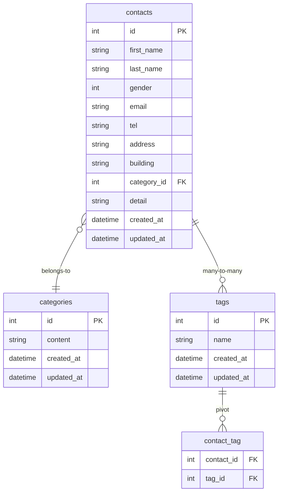

# COACHTECH お問い合わせフォーム

## 概要
Laravel 10 / MySQL / Docker / Sail を使用したお問い合わせフォームアプリケーションです。
一般ユーザー向けの問い合わせ送信機能と、管理者向けの問い合わせ管理機能を実装します。

## ER図


## 環境構築手順

### 1. Laravel プロジェクト作成
```
docker run --rm \
    -u "$(id -u):$(id -g)" \
    -v "$(pwd):/var/www/html" \
    -w /var/www/html \
    -e COMPOSER_CACHE_DIR=/tmp/composer_cache \
    laravelsail/php82-composer:latest \
    composer create-project laravel/laravel:^10.0 contact-form-app
```

### 2. Sail インストール
```
cd contact-form-app
docker run --rm \
    -u "$(id -u):$(id -g)" \
    -v "$(pwd):/var/www/html" \
    -w /var/www/html \
    -e COMPOSER_CACHE_DIR=/tmp/composer_cache \
    laravelsail/php82-composer:latest \
    composer require laravel/sail --dev

docker run --rm \
    -u "$(id -u):$(id -g)" \
    -v "$(pwd):/var/www/html" \
    -w /var/www/html \
    -e COMPOSER_CACHE_DIR=/tmp/composer_cache \
    laravelsail/php82-composer:latest \
    php artisan sail:install --with=mysql
```

### 3. .env の設定
```
DB_CONNECTION=mysql
DB_HOST=mysql
DB_PORT=3306
DB_DATABASE=laravel
DB_USERNAME=sail
DB_PASSWORD=password
```
※ DB_HOST はDockerコンテナ名である mysql を指定します。

### 4. フロントエンドのセットアップ (Vite & Tailwind CSS)
※重要: sail npm install を実行する前に、必ずSailコンテナが起動していることを確認してください。
```
sail npm install
sail npm install -D tailwindcss@^3.4.0 postcss autoprefixer
sail npm install alpinejs
sail npx tailwindcss init -p
```

tailwind.config.js を開き、以下のように設定
```
/** @type {import("tailwindcss").Config} */
export default {
  content: [
    "./resources/**/*.blade.php",
    "./resources/**/*.js",
    "./resources/**/*.vue",
  ],
  theme: {
    extend: {},
  },
  plugins: [],
}
```

### 5. 提供Bladeに変更
プロジェクト内の`resources`フォルダを削除し、クローンした`resources`をコピー
```
git clone https://github.com/coachtech-prepared-file/Preparedblade-ConfirmationTest-ContactForm.git
```

### 6. phpMyAdminの追加
compose.yaml に追加する内容
```yaml
    phpmyadmin:
        image: 'phpmyadmin:latest'
        ports:
            - '${FORWARD_PHPMYADMIN_PORT:-8080}:80'
        environment:
            PMA_HOST: mysql
            PMA_USER: '${DB_USERNAME}'
            PMA_PASSWORD: '${DB_PASSWORD}'
        networks:
            - sail
        depends_on:
            - mysql
```

### 7. sailの起動
```bash
./vendor/bin/sail up -d
```

### 8. アプリケーションキーの生成
```
sail artisan key:generate
```

### 9. マイグレーション & 初期データ投入

```bash
sail artisan migrate --seed
```

## 使用技術
- Laravel 10.x
- PHP 8.2
- MySQL 8.0
- Docker / Laravel Sail
- Nginx
- Tailwind CSS 3.4

## APIエンドポイント一覧
---

### 1. お問い合わせ一覧取得（検索 + ページネーション）
**GET /api/v1/contacts**

| パラメータ | 型 | 必須 | 説明 |
|-----------|------|------|------|
| keyword | string | 任意 | 氏名・メールの部分一致検索 |
| gender | int | 任意 | 1:男性 / 2:女性 / 3:その他 |
| category_id | int | 任意 | カテゴリID（存在チェックあり） |
| date | date | 任意 | created_at の日付一致 |
| page | int | 任意 | ページ番号 |
| per_page | int | 任意 | 1〜100 |

**レスポンス（概要）**  
- `data`: ContactResource の配列  
- `meta`: current_page / last_page / per_page / total  

---

### 2. お問い合わせ詳細取得
**GET /api/v1/contacts/{contact}**

- ContactResource を返却  
- category / tags をネストして返す  

---

### 3. お問い合わせ作成
**POST /api/v1/contacts**

| フィールド | 型 | 必須 | 説明 |
|-----------|------|------|------|
| first_name | string | 必須 | 姓 |
| last_name | string | 必須 | 名 |
| gender | int | 必須 | 1,2,3 |
| email | string | 必須 | メール形式 |
| tel | string | 必須 | ハイフンなし10〜11桁 |
| address | string | 必須 | 住所 |
| building | string | 任意 | 建物名 |
| category_id | int | 必須 | カテゴリID（exists） |
| detail | string | 必須 | 120文字以内 |
| tag_ids | array | 任意 | タグID配列（exists） |

**レスポンス**  
- ContactResource  
- **201 Created**

---

### 4. お問い合わせ更新
**PUT /api/v1/contacts/{contact}**

- バリデーションは POST と同じ  
- `tag_ids` が空の場合はタグ全解除（sync([])）

**レスポンス**  
- ContactResource  
- **200 OK**

---

### 🗑 5. お問い合わせ削除
**DELETE /api/v1/contacts/{contact}**

**レスポンス**  
- **204 No Content**

---

## 開発環境URL
 http://localhost

 ## 作成者
  有富　友紀
