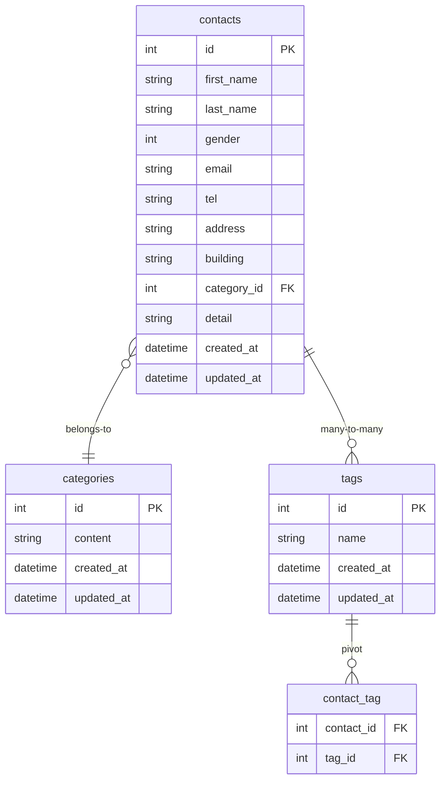

# COACHTECH お問い合わせフォーム

## 目次
1. [概要](#概要)
2. [アーキテクチャ](#アーキテクチャ)
3. [ER図](#er図)
4. [環境構築手順（開発用）](#環境構築手順)
5. [開発環境URL](#開発環境url)
6. [使用技術](#使用技術)
7. [APIエンドポイント一覧](#apiエンドポイント一覧)
8. [アプリ実行手順（採点者向け）](#環境構築手順-1)
9. [アクセスURL](#アクセス-url)
10. [テスト状況](#テスト状況)
11. [ディレクトリ構成](#ディレクトリ構成実装部分のみ抜粋)
13. [作成者](#作成者)


## 概要
Laravel 10 / MySQL / Docker / Sail を使用したお問い合わせフォームアプリケーションです。
一般ユーザー向けの問い合わせ送信機能と、管理者向けの問い合わせ管理機能を実装します。
また、応用機能として問い合わせ内容のCSVエクスポートと公開API（CRUD）を実装しています。

---

## アーキテクチャ
アーキテクチャはWeb版と公開APIそれぞれ実装しています。

### Webブラウザ向け機能（Traditional Web / SSR）
- Bladeテンプレート
- Fortifyによるセッション認証（Cookie）
- ルーティング：`routes/web.php`
- コントローラー：`App\Http\Controllers`配下
- お問い合わせ入力→お問い合わせ確認→サンクスページの流れをSSRで実装

### 公開API
問い合わせデータを操作できる 公開API（CRUD） を実装
- ルーティング：`routes/api.php`
- コントローラー：`App\Http\Controllers\Api\V1` 配下
- 認証不要（Sanctum は使用しません）
- お問い合わせの一覧表示・詳細表示・登録・更新・削除が可能

---

## ER図


---

## 環境構築手順
※本課題における開発における環境構築手順をまとめる。
なお、以下を基に作成したWebアプリケーション・公開APIの実行手順は*アプリ実行手順"に記載します。

### 1. Laravel プロジェクト作成
```bash
docker run --rm \
    -u "$(id -u):$(id -g)" \
    -v "$(pwd):/var/www/html" \
    -w /var/www/html \
    -e COMPOSER_CACHE_DIR=/tmp/composer_cache \
    laravelsail/php82-composer:latest \
    composer create-project laravel/laravel:^10.0 contact-form-app
```

### 2. Sail インストール
```bash
cd contact-form-app
docker run --rm \
    -u "$(id -u):$(id -g)" \
    -v "$(pwd):/var/www/html" \
    -w /var/www/html \
    -e COMPOSER_CACHE_DIR=/tmp/composer_cache \
    laravelsail/php82-composer:latest \
    composer require laravel/sail --dev

docker run --rm \
    -u "$(id -u):$(id -g)" \
    -v "$(pwd):/var/www/html" \
    -w /var/www/html \
    -e COMPOSER_CACHE_DIR=/tmp/composer_cache \
    laravelsail/php82-composer:latest \
    php artisan sail:install --with=mysql
```

### 3. .env の設定
```
DB_CONNECTION=mysql
DB_HOST=mysql
DB_PORT=3306
DB_DATABASE=laravel
DB_USERNAME=sail
DB_PASSWORD=password
```
※ DB_HOST はDockerコンテナ名である mysql を指定します。

### 4. フロントエンドのセットアップ (Vite & Tailwind CSS)
※重要: sail npm install を実行する前に、必ずSailコンテナが起動していることを確認してください。
```bash
sail npm install
sail npm install -D tailwindcss@^3.4.0 postcss autoprefixer
sail npm install alpinejs
sail npx tailwindcss init -p
```

tailwind.config.js を開き、以下のように設定
```
/** @type {import("tailwindcss").Config} */
export default {
  content: [
    "./resources/**/*.blade.php",
    "./resources/**/*.js",
    "./resources/**/*.vue",
  ],
  theme: {
    extend: {},
  },
  plugins: [],
}
```

### 5. 提供Bladeに変更
プロジェクト内の`resources`フォルダを削除し、クローンした`resources`をコピー
```bash
git clone https://github.com/coachtech-prepared-file/Preparedblade-ConfirmationTest-ContactForm.git
```

### 6. phpMyAdminの追加
compose.yaml に追加する内容
```yaml
    phpmyadmin:
        image: 'phpmyadmin:latest'
        ports:
            - '${FORWARD_PHPMYADMIN_PORT:-8080}:80'
        environment:
            PMA_HOST: mysql
            PMA_USER: '${DB_USERNAME}'
            PMA_PASSWORD: '${DB_PASSWORD}'
        networks:
            - sail
        depends_on:
            - mysql
```

### 7. sailの起動
```bash
./vendor/bin/sail up -d
```

### 8. アプリケーションキーの生成
```bash
sail artisan key:generate
```

### 9. マイグレーション & 初期データ投入

```bash
sail artisan migrate --seed
```

---
## 開発環境URL
 http://localhost

---

## 使用技術
- Laravel 10.x
- PHP 8.2
- MySQL 8.0
- Docker / Laravel Sail
- Nginx
- Tailwind CSS 3.4
- Vite

---

## APIエンドポイント一覧

### 1. お問い合わせ一覧取得（検索 + ページネーション）
**GET /api/v1/contacts**

| パラメータ | 型 | 必須 | 説明 |
|-----------|------|------|------|
| keyword | string | 任意 | 氏名・メールの部分一致検索 |
| gender | int | 任意 | 1:男性 / 2:女性 / 3:その他 |
| category_id | int | 任意 | カテゴリID（存在チェックあり） |
| date | date | 任意 | created_at の日付一致 |
| page | int | 任意 | ページ番号 |
| per_page | int | 任意 | 1〜100 |


**レスポンス（概要）**  
- `data`: ContactResource の配列  
- `meta`: current_page / last_page / per_page / total  


### 2. お問い合わせ詳細取得
**GET /api/v1/contacts/{contact}**

- ContactResource を返却  
- category / tags をネストして返す  


### 3. お問い合わせ作成
**POST /api/v1/contacts**

| フィールド | 型 | 必須 | 説明 |
|-----------|------|------|------|
| first_name | string | 必須 | 姓 |
| last_name | string | 必須 | 名 |
| gender | int | 必須 | 1,2,3 |
| email | string | 必須 | メール形式 |
| tel | string | 必須 | ハイフンなし10〜11桁 |
| address | string | 必須 | 住所 |
| building | string | 任意 | 建物名 |
| category_id | int | 必須 | カテゴリID（exists） |
| detail | string | 必須 | 120文字以内 |
| tag_ids | array | 任意 | タグID配列（exists） |

**レスポンス**  
- ContactResource  
- **201 Created**


### 4. お問い合わせ更新
**PUT /api/v1/contacts/{contact}**

- バリデーションは POST と同じ  
- `tag_ids` が空の場合はタグ全解除（sync([])）

**レスポンス**  
- ContactResource  
- **200 OK**


### 5. お問い合わせ削除
**DELETE /api/v1/contacts/{contact}**

**レスポンス**  
- **204 No Content**

---

## 環境構築手順
このアプリケーションは Docker / Laravel Sail を使用して動作します。
ホストマシンに PHP や Composer をインストールする必要はありません。

ただし、初回のみ Sail を使うための vendor を生成する必要があるため、Composer を Docker コンテナ経由で実行します。  
（ホストに Composer をインストールする必要はありません）

### 1.リポジトリのクローン

```bash
git clone git@github.com:aridome-sashizume/contact-form-app.git
cd contact-form-app
```
### 2.Composer インストール
`.env.example` は Sail 用の DB 設定済み です。

```bash
cp .env.example .env
```

### 3. Composer install（ホストに Composer 不要）
```bash
docker run --rm \
    -u "$(id -u):$(id -g)" \
    -v "$(pwd):/var/www/html" \
    -w /var/www/html \
    laravelsail/php82-composer:latest \
    composer install
```

### 4. Sail の起動
```bash
./vendor/bin/sail up -d
```

### 5.フロントエンドのセットアップ（Tailwind CSS を含む）
Tailwind CSS はすでにプロジェクトに含まれています。
```bash
./vendor/bin/sail npm install
./vendor/bin/sail npm run build
```
※ 開発用の npm run dev は不要です。

### 6. アプリケーションキー生成
```bash
./vendor/bin/sail artisan key:generate
```

### 7.データベース初期化
```bash
./vendor/bin/sail artisan migrate:fresh --seed
```

## アクセス URL
- フロント画面
　http://localhost/

- 管理画面
　http://localhost/admin
　※管理画面ログイン情報（初期データ）
```
メール: admin@example.com
パスワード: password
```
## テスト実行
```bash
./vendor/bin/sail artisan test
```
---

## テスト状況
- Unitテスト（FormRequest）：全完了
- Featureテスト（API）：全完了
- Fortify：ログイン・登録のみ使用（Reset/UpdatePassword/Profileは対象外）
- coverage：88%（Laravel内部機能は未使用のため対象外）
---

## ディレクトリ構成（実装部分のみ抜粋）
```
app/
├── Actions/
│   └── Fortify
│       └── CreateNewUser.php
├── Http/
│   ├── Controllers/
│   │   ├── ContactController.php
│   │   ├── AdminController.php
│   │   ├── TagController.php
│   │   └─ Api/V1
│   │        └── ContactController.php
│   ├── Requests/
│   │   ├── StoreContactRequest.php
│   │   ├── UpdateContactRequest.php
│   │   ├── IndexContactRequest.php
│   │   ├── StoreTagRequest.php
│   │   ├── UpdateTagRequest.php
│   │   ├── ExportContactRequest.php
│   │   └── Api/V1
│   │        ├── IndexContactRequest.php
│   │        ├── StoreContactRequest.php
│   │        └── UpdateContactRequest.php
│   └── Resources/
│       ├── CategoryResource.php
│       ├── ContactResource.php
│       └── TagResource.php
├── Models/
│   ├── Contact.php
│   ├── Category.php
│   ├── Tag.php
│   └── User.php
├── Providers/
│   ├── FortifyServiceProvider.php
│   └── RouteServiceProvider.php
├── routes/
│   ├── web.php
│   └── api.php
├── resources/
│         ├── views/
│             └── contact/
│                 ├── _form.blade.php
│                 ├── confirm.blade.php
│                 ├── index.blade.php
│                 └── thanks.blade.php 
tests/
├── Feature/
│   ├── Api/V1/
│   │   ├── DeleteContactFeatureTest.php
│   │   ├── IndexContactFeatureTest.php
│   │   ├── ShowContactFeatureTest.php
│   │   ├── StoreContactFeatureTest.php
│   │   └── UpdateContactFeatureTest.php
│   ├── AdminFeatureTest.php
│   ├── AuthFeatureTest.php
│   ├── ContactFeatureTest.php
│   ├── CsvExportContactTest.php
│   └── TagFeatureTest.php
└── Unit/
│   ├── Api/V1/
│   |    ├── IndexContactRequestTest.php
│   |    ├── StoreContactRequestTest.php
│   |    └── UpdateContactRequestTest.php
│   ├── CategoryTest.php
│   ├── ContactTest.php
│   ├── ExportContactRequestTest.php
│   ├── IndexContactRequestTest.php
│   ├── TagTest.php
|   └── UpdateTagRequestTest.php
├── CreatesApplication.php
└── TestCase.php
```

---

 ## 作成者
  有富　友紀
